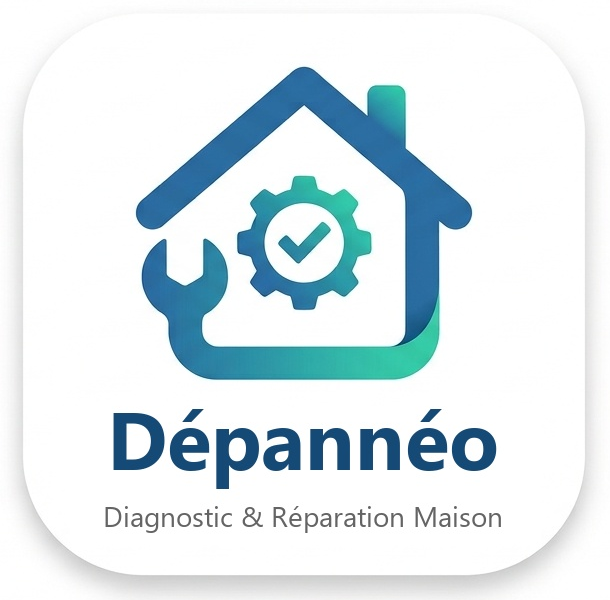

<p align="center">
  
</p>

# Dépannéo

[](https://github.com/elios134/depanneo/actions/workflows/verification.yml)

Une appli mobile qui aide les particuliers face à une panne de **plomberie** ou d'**électricité simple** à la maison : diagnostic guidé, gestes d'urgence, tutos avec schémas animés, et les plombiers et électriciens les plus proches sur une carte.

Projet portfolio d'André, ancien plombier et technicien de maintenance (10 ans de terrain) en reconversion dans le développement. Le contenu des diagnostics et des tutos vient de ce vécu.

## Fonctionnalités

- **Diagnostic guidé** : 22 pannes (fuite, WC bouché, plus d'eau chaude, disjoncteur qui saute…). Quelques questions simples, puis un verdict : 🟢 je peux réparer, 🟠 je sécurise en attendant un pro, 🔴 j'appelle un pro tout de suite.
- **Urgences** en un appui : couper l'eau, couper le courant, « Odeur de gaz ? » avec le numéro d'urgence.
- **10 tutos** pas à pas, illustrés par des schémas animés, avec un « Plan B » quand la première méthode ne suffit pas.
- **Carte des pros** (OpenStreetMap) : plombiers et électriciens proches, appel en un appui.
- Diagnostic, urgences et tutos **fonctionnent sans réseau**.

> L'appli donne des conseils, elle ne remplace pas un professionnel.

## Technique

- React Native + Expo (Expo Router), TypeScript strict, Jest.
- Schémas animés en SVG (react-native-svg), décrits comme des données et animés par des fonctions pures testées.
- Carte : MapLibre + OpenFreeMap ; pros : Overpass (OpenStreetMap).

## Lancer le projet

```bash
npm install
npx expo start --web
```

La carte native demande un build de développement : voir [docs/build-android.md](docs/build-android.md).

```bash
npx jest
```
